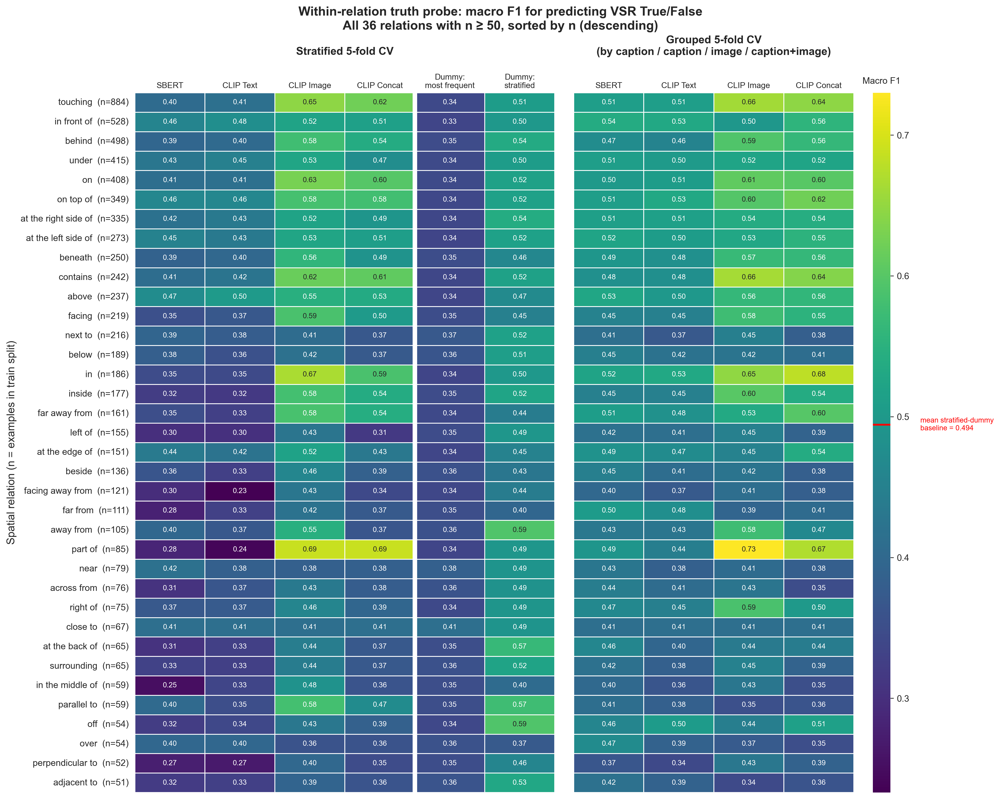

# Spatial Reasoning Probing Study

**Does visual training help language models understand space?**

One known weakness of language models is spatial reasoning. Having learned from text alone, they have no perceptual grounding for concepts like *above*, *left of*, or *inside* — they've only ever seen these words in context, never experienced what they refer to.

CLIP changes the training regime: instead of predicting masked tokens, it learns to align image-caption pairs. The hypothesis here is that this contrastive image-text training leaves a residue in the text embedding space — making spatial relations more linearly decodable, even when no image is present at inference time.

This study tests that hypothesis using **probing classifiers**: lightweight logistic regression models trained on frozen embeddings to ask whether spatial relation labels are linearly decodable from each representation.

> *N.B. I am disclosing that I used AI (Claude Code) to assist with coding in this project, as encouraged in the course.*

---

## Initial Research Question

> Are spatial relations more linearly decodable from text embeddings produced by image–text contrastive training in a multimodal model (CLIP) than from those produced by text–text contrastive training in a text-only model (SBERT)? 

---

## Main Deliverable

[Gully_Probing_Study.ipynb](Gully_Probing_Study.ipynb)

## Results Summary

Within-relation truth probe: for each relation with at least 50 training examples, a probe is trained on that relation's examples to predict VSR's True/False caption label.

- Probe: `StandardScaler` + logistic regression (C=1.0)
- Cross-validation: grouped 5-fold (`StratifiedGroupKFold`), grouped by caption (SBERT, CLIP Text), by image (CLIP Image), or jointly by caption and image (CLIP Concat)
- Metric: macro F1
- Chance reference: label-permutation test, 1,000 shuffles within each relation; p-values are one-sided, and the smallest possible value is 0.001

All 36 relations (n ≥ 50):

| Condition | Mean | Median | Min | Max | Permutation null mean (95% range) | p for the mean | Relations with p < 0.05 (raw / Holm) |
|---|---|---|---|---|---|---|---|
| SBERT (`all-mpnet-base-v2`) | 0.487 | 0.489 | 0.386 | 0.592 | 0.482 (0.463–0.500) | 0.288 | 0 / 0 |
| CLIP Text encoder | 0.489 | 0.481 | 0.410 | 0.589 | 0.482 (0.463–0.501) | 0.234 | 0 / 0 |
| CLIP Image encoder | 0.543 | 0.530 | 0.374 | 0.701 | 0.492 (0.472–0.511) | 0.001 | 12 / 6 |
| CLIP Concat (image + text, 1024d) | 0.553 | 0.551 | 0.323 | 0.709 | 0.486 (0.468–0.506) | 0.001 | 13 / 6 |

The 19 relations with n ≥ 150:

| Condition | Mean | Median | Min | Max | Permutation null mean (95% range) | p for the mean | Relations with p < 0.05 (raw / Holm) |
|---|---|---|---|---|---|---|---|
| SBERT (`all-mpnet-base-v2`) | 0.493 | 0.493 | 0.446 | 0.518 | 0.488 (0.471–0.505) | 0.304 | 0 / 0 |
| CLIP Text encoder | 0.495 | 0.506 | 0.446 | 0.545 | 0.488 (0.471–0.506) | 0.215 | 0 / 0 |
| CLIP Image encoder | 0.573 | 0.550 | 0.465 | 0.693 | 0.497 (0.479–0.515) | 0.001 | 10 / 7 |
| CLIP Concat (image + text, 1024d) | 0.579 | 0.586 | 0.466 | 0.709 | 0.493 (0.475–0.511) | 0.001 | 10 / 8 |

SBERT vs CLIP Text, relations won / tied / lost by SBERT (tie = difference < 1e-9), all 36 relations: 17 / 0 / 19.

With plain stratified folds instead of grouped folds, mean macro F1 over the 36 relations is 0.308 / 0.304 / 0.539 / 0.478 (SBERT / CLIP Text / CLIP Image / CLIP Concat).

Full tables: [results/truth_probe/](results/truth_probe/). Other settings and checks (regularization sweep, repeated captions across stratified folds, interaction features, bag-of-words baseline): [results/diagnostics/](results/diagnostics/).

### Main Results Heatmap



### Correction

The first version of this project probed relation identity (a one-vs-rest "is this caption about relation X?" classifier over all 7,680 examples) rather than caption truth within each relation. Those results are kept in [results/relation_identity/](results/relation_identity/), with the corresponding heatmap at [results/figures/05_relation_identity_heatmap.png](results/figures/05_relation_identity_heatmap.png).


---

## Models

| Model | Type | Training Objective | Visual Signal |
|---|---|---|---|
| `sentence-transformers/all-mpnet-base-v2` | SBERT (MPNet-based) | Contrastive, over 1 billion sentence pairs | None |
| `openai/clip-vit-base-patch32` (text encoder) | CLIP Text | Contrastive image-text | Indirect |
| `openai/clip-vit-base-patch32` (image encoder) | CLIP Image | Contrastive image-text | Direct |
| CLIP text + image (concat, 1024d) | CLIP Concat | Contrastive image-text | Both |

---

## Dataset

**VSR — Visual Spatial Reasoning** (Liu et al., 2022)
- ~7,680 training examples (image, caption, relation type, True/False label)
- 64 relation types; 36 retained after filtering relations with fewer than 50 examples
- Images are COCO images fetched at runtime; only filenames stored in the HuggingFace dataset

---

## Reproducing the Results

### Environment

```bash
git clone https://github.com/nogully/spatial_probing.git
cd spatial_probing
python -m venv .venv && source .venv/bin/activate
pip install -r requirements.txt
```

### Embedding Extraction (Google Colab — GPU required)

You may need:
- A **GitHub Personal Access Token** (to clone the repo in Colab - should be able to do without tho)
- A **HuggingFace token** (optional - to suppress rate-limit warnings when downloading models)

Open `notebooks/02_embedding_extraction.ipynb`, run the Colab setup cell (mounts Drive, clones repo, installs deps), then run all cells. Embeddings are cached to Google Drive as `.npy` files.

Sync the following files to `results/embeddings/` locally before running probing:
- `sbert_vsr_train.npy`
- `clip_text_vsr_train.npy`
- `clip_image_vsr_train.npy`
- `clip_concat_vsr_train.npy`

### Probing and Visualization (local)

Run the permutation test, then notebooks 03, 04 + 05 locally:

```
python permutation_test.py --standardize --C 1.0 --cv grouped --models sbert clip_text clip_image clip_concat
notebooks/03_probing_experiments.ipynb   # trains probes, saves CSVs to results/truth_probe/
notebooks/04_diagnostics.ipynb           # extra analyses, saves CSVs to results/diagnostics/
notebooks/05_visualization.ipynb         # all graphics (I like data viz)
```

---

## Project Structure

```
spatial_probing/
├── README.md
├── Gully_Probing_Study.ipynb    # main deliverable (loads pre-computed results)
├── Gully_Probing_Study.html
├── requirements.txt
├── smoke_test.py
├── permutation_test.py       # label-permutation test for the truth probe
├── .env.example                 # copy to .env (gitignored) and set CACHE_DIR
│
├── notebooks/
│   ├── 02_embedding_extraction.ipynb    # run on Colab
│   ├── 03_probing_experiments.ipynb
│   ├── 04_diagnostics.ipynb
│   └── 05_visualization.ipynb
│
├── src/
│   ├── datasets.py              # VSR loader
│   ├── embedders.py             # SBERT, CLIP text, image, concat embedders
│   └── probing.py               # logistic regression probes + CV
│
└── results/
    ├── embeddings/              # cached .npy files — gitignored
    ├── truth_probe/             # within-relation True/False probe results
    ├── relation_identity/       # earlier one-vs-rest relation-identity results
    ├── diagnostics/             # extra analyses
    └── figures/                 # output plots
```

---

## References

- Radford et al. (2021) — CLIP: [Learning Transferable Visual Models From Natural Language Supervision](https://arxiv.org/abs/2103.00020)
- Reimers & Gurevych (2019) — SBERT: [Sentence-BERT](https://arxiv.org/abs/1908.10084)
- Liu et al. (2022) — VSR: [Visual Spatial Reasoning](https://arxiv.org/abs/2205.00363)


---

## Author

Nora Gully — University of Colorado Boulder, CSCI 4622 Machine Learning, Spring 2026
